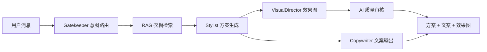
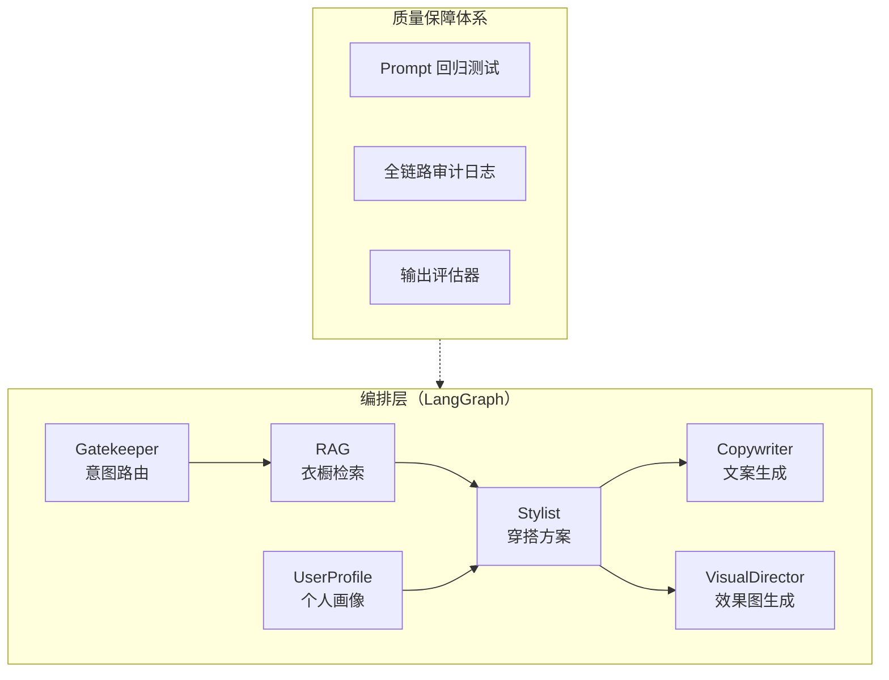
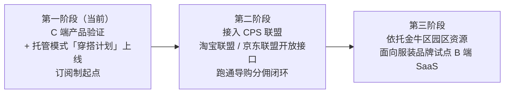

# OOTD-Agent 商业计划书

> **AI 私人造型师，穿衣搭配新方式**
> 参赛方向：数字经济 · 人工智能研发及应用
> 版本：V1（初稿）｜ 2026 年 10 月

---

## 一、项目概述

### 1.1 一句话定位

OOTD-Agent 是一款基于多智能体（Multi-Agent）架构的 AI 穿搭助手：用户管理自己的数字衣橱，AI 像私人造型师一样，结合天气、场合与个人偏好，直接给出穿搭方案和上身效果图——**不用每天纠结穿什么，照着穿就行**。

### 1.2 我们要解决的问题

**穿衣搭配是全民高频刚需，却长期没有被服务好。**

- **决策烦恼**：「今天穿什么」是每个人每天的高频微决策。早晨站在衣柜前的时间消耗与选择焦虑，是真实、普遍、每天发生的痛点
- **衣橱闲置**：「满柜子衣服，却总觉得没衣服穿」——大量单品被遗忘，衣橱利用率低，间接造成重复购买与浪费
- **场景焦虑**：穿搭需求横跨日常办公、旅游出行、节假日聚会、商务场合等全场景，不同场景对天气、行程、礼仪的要求各不相同，普通人很难每次都搭对

需求的普遍性决定了这不是小众工具：只要穿衣服的人，就是潜在用户。

### 1.3 解决方案：对话 + 托管的双模式 AI 穿搭服务

| 模式                   | 解决什么                  | 怎么用                                             |
| -------------------- | --------------------- | ----------------------------------------------- |
| **对话模式**（邀请制内测）      | 探索型需求：「约会穿什么」「白裙子怎么搭」 | 像聊天一样告诉 AI，秒级获得方案 + 效果图                         |
| **托管模式「穿搭计划」**（近期迭代） | 高频日常：每天穿什么            | AI 按天气、行程、穿着历史定时生成今日穿搭，推送穿搭图，用户照着穿即可，**无需每天询问** |

### 1.4 三大核心亮点

1. **多智能体工程闭环**：意图路由、衣橱检索、方案生成、文案、效果图由五个专业 Agent 协同完成，配套 Prompt 回归测试与全链路审计日志，输出质量可度量、可回归——这在 AI 应用中是稀缺能力
2. **双模式产品形态**：对话模式解决「问得到」，托管模式解决「懒得问」，从工具升级为服务，支撑订阅制商业模式
3. **双轮商业化路径**：C 端订阅（托管服务）+ 电商联合（导购分佣、B 端 SaaS），产品架构已为商业化预留接口

### 1.5 当前进展（如实陈述）

产品已完成核心链路开发并**部署上线（[www.meetu.online/ootd](http://www.meetu.online/ootd)）**：对话式穿搭咨询、数字衣橱管理、个人画像、AI 效果图生成与机器审核均已实现，当前处于**邀请制内测**阶段（可为评委开通体验账号）；已启动生成式 AI 服务登记，登记完成后全面开放。托管模式「穿搭计划」为下一步迭代，多智能体管线可全部复用。

---

## 二、行业与市场分析

### 2.1 市场大盘：万亿级服装电商，线上化持续加深

- 2025 年，我国服装（B2C）网络零售额达 **2.38 万亿元**，占全国网络零售额的 14.9%，服装稳居内销电商第一大品类（来源：中国纺织工业联合会流通分会，国家统计局数据）
- 2026 年上半年，穿类商品网上零售额同比增长 **6.2%**，增速较 2025 年全年加快 4.3 个百分点，线上销售明显提速（来源：国家统计局）

### 2.2 行业痛点：高退货率正在成为服装电商的「利润黑洞」

- 女装线上渠道平均退货率处于 **50%~60%** 区间，单次退货综合成本约 **16 元**，众多女装企业面临「销量越高、亏损越多」的困境（来源：中国纺织工业联合会，2026 年 8 月）
- 直播与内容电商时代退货率进一步攀升，部分平台女装退货率达 **80%**，极端店铺达 95%、结算率仅 5%（来源：中国服装协会，2026 女装大会）
- 电商平台考核导向已从单一 GMV 转向**净成交、佣金收益与整体利润贡献**——降退货率从「商家诉求」升级为「平台导向」，解决这一问题的服务迎来付费窗口期（来源：中国服装协会）

退货的重要根源之一是**购买前无法预知穿搭效果**：消费者凭想象下单，到手不满意即退。这正是 AI 穿搭与虚拟试衣的价值切入点。

### 2.3 赛道机会：AI 穿搭/虚拟试衣进入规模化商用拐点

- 2026 年中国虚拟试衣市场规模预计约 **82.3 亿元**，年复合增长率 **46.7%**，主流电商平台服饰类目渗透率有望突破 **28%**（来源：艾瑞咨询 × IDC《2025 中国数字零售技术白皮书》）
- 行业数据显示，虚拟试衣/AI 穿搭技术可使退货率下降 **18~37%**、转化率提升约 **23%**；68.4% 的线上购衣用户表示「愿为虚拟试衣功能多停留 90 秒以上」（来源：QuestMobile，行业报告转引）
- 行业正从「项目制交付」向「SaaS 化订阅」转型：年订单量超 10 万次的平台型客户占比从 2024 年的 18.5% 跃升至 2026 年的 44.1%，轻量化、订阅制的 AI 穿搭服务成为主流形态（来源：行业研究报告）

### 2.4 政策与区域契合

本项目属于本次大赛「数字经济」方向中**人工智能研发及应用、数字产品服务平台打造**领域；成都市及金牛区正大力发展人工智能与数字经济产业，金牛区设有 AI 数字创智元等产业载体并提供算力补贴等配套支持，项目方向与区域产业政策高度契合。

---

## 三、产品与技术

### 3.1 产品形态：双模式 AI 穿搭服务

**对话模式（已实现）**：用户以自然语言发起穿搭咨询（「周末约会穿什么」「这条白裙子怎么配」），系统即时生成穿搭方案、文案与上身效果图。

**托管模式「穿搭计划」（近期迭代）**：系统按天气、行程、穿着历史主动生成今日/本周穿搭，以穿搭图卡片推送，用户照着穿即可。它解决的是高频日常场景的决策疲劳，也是订阅制的核心服务——**问答免费，托管收费，订阅卖的不是提问次数，是「穿搭被接管」**。

> 架构说明：托管模式并非另起炉灶——多智能体管线全部复用，仅新增触发层（定时/天气突变/行程事件）与推送层，这是架构前瞻性的直接体现。

> 形态与触达：产品当前为 **Web 应用**（已上线、邀请制内测，响应式设计适配移动端浏览器）。Web 先行是主动选择：零安装门槛、链接即传播、验证期迭代最快；托管模式的每日触达规划接入**微信生态（小程序 + 服务通知）**这一国内 C 端召回主通道——前后端分离架构下服务端 API 完整复用，小程序端仅为壳化适配。

### 3.2 全场景体验画面

| 场景    | 产品表现                          |
| ----- | ----------------------------- |
| 日常通勤  | 早上 7 点收到今日穿搭卡片（已结合当日天气），照着穿出门 |
| 差旅出行  | 按目的地天气与行程天数生成打包清单，一箱搞定不多带     |
| 节假日聚会 | 按场合氛围生成造型方案与效果图               |
| 度假旅游  | 胶囊衣橱：少量单品组合出一周不重样             |
| 购物前   | 看中的衣服先与自己衣橱 AI 预搭配，买得起更搭得起    |

### 3.3 核心功能链路

一次典型请求：用户说「明天去青城山爬山穿什么」→ Gatekeeper 识别为穿搭意图并提取场景要素 → RAG 从用户数字衣橱中检索候选单品（颜色、季节过滤 + 向量相似度）→ Stylist 生成搭配方案 → Copywriter 流式输出穿搭建议文案，VisualDirector 并行生成上身效果图 → AI 审核通过后整体呈现。

### 3.4 多智能体（Multi-Agent）架构

| Agent          | 职责                                   | 对应工程模块                        |
| -------------- | ------------------------------------ | ----------------------------- |
| Gatekeeper     | 意图识别与路由，提取场景/单品/风格要素                 | `server/agents/gatekeeper/`   |
| RAG            | 数字衣橱语义检索（双 Embedding 混合检索 + 颜色/季节过滤） | `server/agents/rag/`          |
| Stylist        | 穿搭方案生成与单品选择                          | `server/agents/stylist/`      |
| Copywriter     | 穿搭文案流式生成                             | `server/agents/copywriter/`   |
| VisualDirector | 上身效果图生成与 AI 审核                       | `server/agents/visual/`       |
| UserProfile    | 体型/风格/偏好画像维护                         | `server/agents/user-profile/` |

### 3.5 工程化壁垒：AI 应用最稀缺的「质量可度量」能力

大模型应用人人能做，**稳定可控的大模型应用**极少。我们的壁垒在工程体系：

- **Prompt 回归测试体系**：以真实大模型调用对核心场景（意图判定、检索词生成等）做断言式回归测试，任何 Prompt 改动必须通过场景测试集，防止「改一处、崩全局」（`tests/prompts/`）
- **全链路审计日志**：意图判定分布、检索命中率、效果图审核通过率、文案质量全程落盘可查（`log/gatekeeper-audit.jsonl`、`log/rag-search.jsonl`、`log/visual-audit.jsonl`、`log/copywriter-audit.jsonl`）
- **输出评估器矩阵**：对意图路由、检索质量、单品选择、文案、画像更新分别设有程序化评估器，质量异常可被自动发现
- **混合检索工程**：双 Embedding（图像 + 文本）向量检索叠加颜色/季节规则过滤，兼顾语义相似与硬约束

### 3.6 技术路线选择：为什么是生成式 AI 而非 3D 建模

**行业正在从 3D 路线转向生成式路线，我们与转向同向。**

|          | 3D 建模路线       | 生成式路线（我们的选择）               |
| -------- | ------------- | -------------------------- |
| 单 SKU 成本 | 需逐件 3D 建模，成本高 | 零建模成本，上新即用                 |
| 交付形态     | 项目制、重部署       | 天然 SaaS 化                  |
| 行业趋势     | 重资产玩家并购整合     | 生成式试衣已在头部平台商用，行业转向 SaaS 订阅 |

**「虚拟化如何真实」的工程回答**：穿搭展示的核心诉求是搭配效果预览（风格、色彩、整体感），生成式 AI 已能良好满足；我们的真实性保障是「生成 + 机器复审」双保险——专用 Prompt 构建管线约束生成要素，AI 审核模型对效果图逐张打分，不合格自动重生成或拦截。我们也清楚路线边界：毫米级合身度（尺码、面料垂坠物理仿真）非生成式所长，规划通过接入专用虚拟试衣模型与合作方式解决（见第九章未来展望），而非自建 3D 的重资产路线。

---

## 四、商业模式

### 4.1 商业化路线图（分阶段，诚实分层）

以下为规划中的商业化路径。产品当前处于第一阶段，推荐结果即为结构化单品数据，架构上已为导购与 B 端输出预留接口。

### 4.2 电商联合（核心变现通路）

穿搭推荐与购买决策天然相邻——AI 告诉用户「该这么搭」的那一刻，就是离成交最近的一刻。规划的电商联合形态：

| 形态           | 说明                                     | 变现方式    |
| ------------ | -------------------------------------- | ------- |
| **CPS 导购分佣** | 推荐单品直达购买链接（接入淘宝联盟、京东联盟等成熟开放接口，无需自建供应链） | 成交额分佣   |
| **品牌合作**     | 新品进入搭配推荐池、场景化内容合作                      | 广告/合作费用 |
| **直播与内容电商**  | 直播间、短视频场景的实时穿搭问答与搭配助手                  | 服务分成    |
| **电商平台插件**   | 为商家店铺提供「AI 穿搭顾问」插件，消费者购前预搭配            | 商家订阅费   |

其中「购前预搭配」直接回应 2.2 节的行业痛点：消费者买之前先看到与自己衣橱的搭配效果，因「到手不满意」产生的退货将显著减少——**对平台是净成交提升，对商家是退货成本下降，对我们是按效果付费的市场**。

### 4.3 B 端 SaaS：AI 穿搭引擎

- **产品**：将多智能体穿搭管线封装为 API/SaaS，服装电商与品牌接入后获得「对话式穿搭顾问 + 效果图生成」能力
- **定价**（规划中）：基础订阅费 + 调用量阶梯计费
- **目标客户**：腰部以上服装电商、女装品牌、直播 MCN——退货率压力最大、且无力自建 AI 团队的群体
- **获客路径**：产业带服务商渠道、电商平台服务商体系、园区场景对接（见第八章）

### 4.4 C 端订阅

问答免费 + 托管收费：对话模式永久免费作为获客入口；托管模式「穿搭计划」（每日穿搭推送、差旅打包、胶囊衣橱）作为订阅服务。订阅卖的不是提问次数，是「穿搭被接管」。

**付费意愿的成立逻辑**：

- **价格锚点**：年费 198 元 ≈ 每月一杯奶茶；线下形象顾问服务一次 500~2000 元，AI 私人造型师一年 198 元
- **省钱逻辑**：盘活衣橱、减少错买——用户一年少买错一件衣服（约 300 元）即值回年费
- **高焦虑场景转化**：约会、差旅、面试等「穿错代价高」的时刻是天然付费触发点，配套托管免费试用期培养使用习惯
- **保守假设**：付费转化率按 2~3% 建模（工具类产品下限），97% 的免费用户同样贡献活跃、口碑与导购佣金基本盘

---

## 五、竞争分析

| 对手类型        | 代表形态          | 它们的短板                       | 我们的差异                       |
| ----------- | ------------- | --------------------------- | --------------------------- |
| 虚拟试衣方案商     | 3D 建模试衣间      | 重资产项目制交付、单 SKU 建模贵、无对话与文案能力 | 生成式路线零建模成本，对话式入口 + 文案效果图一体化 |
| 通用大模型应用     | 通用聊天机器人       | 无用户衣橱数据、无检索与质量工程、答案泛泛不可执行   | 私有衣橱数据 + 混合检索 + 全链路质量体系     |
| 传统穿搭/衣橱 App | 人工搭配社区、衣橱记录工具 | 无生成式 AI 能力，依赖人工内容，规模化难      | 多智能体管线全自动生成，边际成本趋近于零        |

核心护城河随时间加深：**用户的私有衣橱数据与穿着历史**——迁移成本随使用时长增加，数据越多推荐越准，形成正向飞轮。

---

## 六、团队介绍

团队为「产品技术 + 商业市场」的双人核心结构：

| 成员      | 角色          | 职责                                     | 背景                                                                                                                                  |
| ------- | ----------- | -------------------------------------- | ----------------------------------------------------------------------------------------------------------------------------------- |
| **吴昀珠** | 创始人 / 项目负责人 | 产品定义、多智能体系统架构与全栈开发、工程质量体系建设            | 杭州电子科技大学软件工程本科；8 年前端/全栈工程经验，曾任**字节跳动高级前端工程师**，负责 TikTok 千万级 DAU Web 核心链路；2025 年起专注 AI Agent 工程，已独立研发并上线两套多智能体应用（AI 穿搭、多镜头视频生成），现居成都 |
| **陈鸿菱** | 联合创始人       | 商业化落地与市场拓展：电商联合与品牌合作对接、B 端客户拓展、用户增长与运营 | ⚠️【待补充：学校/专业或工作经历一句】                                                                                                                |

分工逻辑：吴昀珠负责把产品做「对」（架构、质量、体验），陈鸿菱负责把产品卖「出去」（合作、渠道、增长）；路演答辩亦按此分工，分别回应技术类与商业类问题。

---

## 七、财务与融资规划

### 7.1 三年收入预测

**定价依据**（模型的全部假设，均可现场解释）：

- C 端订阅：25 元/月或 198 元/年，考虑月付流失，年均客单价按 150~180 元计；付费转化率按工具类产品保守值 2~3%
- CPS 导购分佣：按导购成交额（GMV）的 5% 计（电商联盟服饰类目常见佣金率区间 5%~10%，取下限）
- B 端 SaaS：基础版 3 万元/年/客户起
- 成本侧：单次完整生成链路（意图+检索+方案+文案+效果图）的大模型调用成本约 0.3 元，随提示词优化、任务分级路由与行业 Token 价格下行持续摊薄；其余为云基础设施与人力

| 年度          | C 端订阅                                  | 电商联合                                   | B 端 SaaS                | 合计         |
| ----------- | -------------------------------------- | -------------------------------------- | ----------------------- | ---------- |
| 第 1 年（2027） | 注册用户 3 万，付费 800 人 × 150 元 = 12 万元      | CPS 试点 GMV 60 万 × 5% = 3 万元            | —                       | **15 万元**  |
| 第 2 年（2028） | 注册用户 20 万，付费 6,000 人 × 165 元 ≈ 100 万元  | GMV 500 万 × 5% = 25 万元 + 品牌合作 20 万元    | 试点客户 5 家 × 3 万元 = 15 万元 | **160 万元** |
| 第 3 年（2029） | 注册用户 60 万，付费 20,000 人 × 180 元 = 360 万元 | GMV 2,000 万 × 5% = 100 万元 + 品牌合作 40 万元 | 客户 15 家 × 4 万元 = 60 万元  | **560 万元** |

前两年为投入期，亏损部分由自有资金、政府创业补贴与天使轮融资覆盖（见 7.2）；第 3 年随订阅规模效应与 B 端起量接近盈亏平衡。

### 7.2 融资需求与用途

**天使轮规划：150 万元，出让 10%**（投后估值 1,500 万元，对应第 2 年预期收入的约 10 倍 PS，处于早期 AI 应用项目常见区间）。资金用途：

| 用途    | 占比  | 说明                         |
| ----- | --- | -------------------------- |
| 产品研发  | 40% | 托管模式、虚拟试衣模型接入、B 端 SaaS 化改造 |
| 市场与获客 | 30% | 内容渠道冷启动、C 端增长实验、B 端试点拓展    |
| 团队    | 20% | 关键岗位（算法、运营）引进              |
| 运营储备  | 10% | 云资源与模型调用储备金                |

在融资到位前，项目以自有资金投入、大赛奖金及政府创业补贴维持运转，保持低烧钱率。

---

## 八、落地规划与就业带动

- **落地意向**：项目计划落户金牛区 **AI 数字创智元 OPC 社区**（本届大赛支持单位），享受创业服务包、算力补贴、租金减免等配套政策；园区产业资源可直接对接 B 端 SaaS 的首批试点场景
- **区域协同**：金牛区正建设人工智能与数字经济产业载体，项目的「AI + 消费」方向与区域产业定位契合；成都服装产业带与直播电商生态为 B 端拓展提供腹地
- **蓉漂叙事**：创始人杭州求学、曾任职于上海字节跳动，后选择回成都独立创业并计划扎根金牛——是「蓉漂」人才回流、以技术反哺本地数字经济的典型路径，与大赛引才导向一致
- **就业带动**（三年规划框架，数字待校准）：

| 年度    | 团队规模    | 新增岗位方向                            |
| ----- | ------- | --------------------------------- |
| 第 1 年 | 3~4 人   | 算法工程、产品（创始人 + 联合创始人 + 1~2 名全职/实习） |
| 第 2 年 | 6~8 人   | + 商业化运营、客户成功                      |
| 第 3 年 | 12~15 人 | + 行业销售、内容团队                       |

---

## 九、未来展望

1. **技术演进三步走**：当前生成式效果图 + AI 审核闭环 → 接入专用虚拟试衣（Try-On）模型，实现「真人照片 + 单品 → 上身效果」→ 与 3D 方案商合作接入身材尺码引擎。坚持轻资产路线，不自研 3D 建模
2. **品类扩展**：从服装穿搭扩展至美妆、配饰、鞋包的整体造型服务
3. **平台化**：开放穿搭 API，让电商、内容社区、智能硬件（试衣镜、穿戴设备）接入穿搭能力，形成穿搭生态
4. **与城市消费场景结合**：对接即时零售、商圈数字化场景，参与成都建设国际消费中心城市与数字经济标杆城市的进程

---

## 十、风险与应对

| 风险            | 影响   | 应对                                                 |
| ------------- | ---- | -------------------------------------------------- |
| 大模型调用成本       | 毛利受压 | 提示词工程降本、缓存与路由分层（按任务复杂度分模型）、行业 Token 价格持续下行趋势       |
| 数据合规（衣橱/形象数据） | 合规风险 | 最小化采集、明示授权、私有化存储、遵循《个人信息保护法》                       |
| 巨头入场          | 竞争挤压 | 深耕私有衣橱数据与工程质量的差异化，巨头做通用、我们做「你的衣橱」；数据飞轮与用户迁移成本是长期屏障 |

